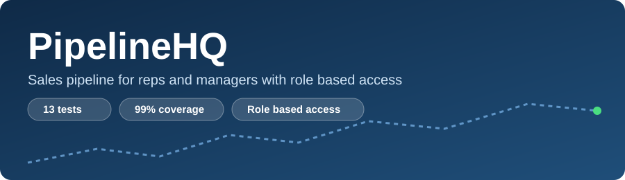
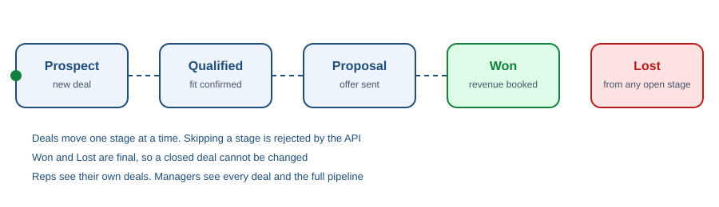

<p align="center"></p>

<p align="center">
  <a href="https://pipelinehq-61gu.onrender.com"></a>
</p>
<p align="center">
  
  
  
  
  
  
</p>

A small CRM style sales pipeline. Sales reps track deals on a board, and managers see the whole team's pipeline, win rate and revenue.

## Try it in 30 seconds
Open the **[live demo](https://pipelinehq-61gu.onrender.com)**. The free server may take about 50 seconds to wake up on the first visit.

| Account | Password | Role | What you see |
|---|---|---|---|
| `meera` | `demo123` | Manager | All deals, team pipeline value and win rate |
| `asha` | `demo123` | Rep | Only her own deals |
| `ravi` | `demo123` | Rep | Only his own deals |

1. Sign in as **asha** and move a deal to the next stage.
2. Add a new deal. It starts at Prospect and belongs to asha.
3. Sign out and sign in as **meera**. The manager sees both reps' deals and updated totals.

## Deal lifecycle
<p align="center"></p>

## Features
| Area | What it does |
|---|---|
| Authentication | Sign in with username and password. Sessions use signed tokens that expire after 8 hours |
| Role based access | Reps see and change only their own deals. Managers see all of them |
| Pipeline board | Five columns with cards, amounts, owners and one click stage moves |
| Business rules | One stage at a time, final Won and Lost states, positive amounts only |
| Analytics | Open pipeline value, won revenue, win rate and value by stage |
| Dashboard | Responsive layout, dark mode, toast messages |

## Security
- Passwords are hashed with PBKDF2 (SHA 256). Plain passwords are never stored or compared.
- Login tokens are signed with HMAC SHA 256 and a secret key from the `SECRET_KEY` environment variable. A tampered or expired token is rejected.
- Role checks happen on the server, not only in the browser.
- A rep who requests another rep's deal gets a "not found" answer, so the deal's existence is not revealed.
- The demo accounts and sample data exist only for this showcase.

## Quality
- **13 automated tests** at **99% coverage**, with a **90% coverage gate** in GitHub Actions CI.
- Tests cover login, tampered and expired tokens, role scoping, cross rep access, every stage rule, win rate maths, validation and sample data.

## API
Interactive documentation is available at `/docs` on the live app.

| Method | Path | Purpose |
|---|---|---|
| POST | `/api/login` | Sign in and receive a token |
| GET | `/api/deals` | List deals visible to the signed in user |
| POST | `/api/deals` | Create a deal (starts at Prospect) |
| POST | `/api/deals/{id}/stage` | Move a deal forward or mark it Lost |
| GET | `/api/stats` | Pipeline value, won revenue, win rate, value by stage |

## Design decisions
- **One function decides visibility.** Every list, stats call and deal lookup goes through it, so a new endpoint cannot forget the role rule.
- **Stage rules live in the API.** The browser only shows buttons, so a hand written request cannot skip a stage either.
- **Win rate counts closed deals only:** won divided by won plus lost.

## Tech stack
Python, FastAPI, SQLite, vanilla JavaScript, pytest, GitHub Actions, Render.

## Run locally
```
pip install -r requirements.txt
python -m uvicorn app.main:app --reload
python -m pytest --cov=app
```
Then open `127.0.0.1:8000` on your own computer. Set `SEED_DEMO=1` to start with sample deals and `SECRET_KEY` to your own value.

## Built by
**Shaik Mohammed Umar** · [LinkedIn](https://linkedin.com/in/mohammed-umarshaik) · [GitHub](https://github.com/shaikumar11) · umarshaikno1@gmail.com
